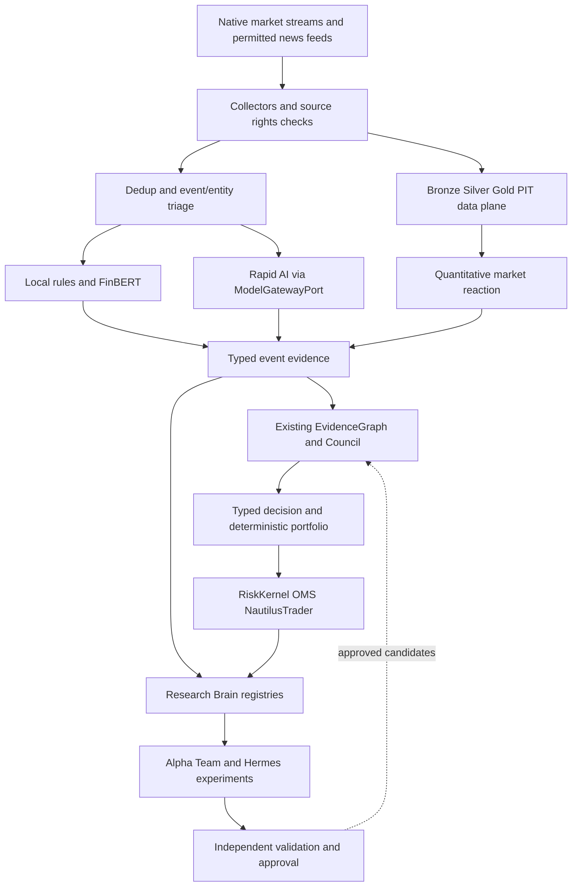

# Free-first live intelligence and adaptive AI routing

**Decision date:** 2026-11-27. **Status:** ADOPTED-IN-PLAN for capability
boundaries; named providers/models are qualification candidates, not admitted
dependencies. **Scope:** full V3 workstation; PAPER-V1 remains unchanged.
See the [architecture authority](../../advisorai-federated-multi-agent-quant-architecture-v3.md),
[Native I1–I9 delivery](native-first-integration-roadmap.md),
[Alpha Team](alpha-team-extension.md), [technology register](../reference/technology-decision-register.md),
and [ADR 0011](../decisions/0011-provider-source-authority-and-pit.md).

## 1. Decision: build the laboratory, let research improve it

Make live acquisition, normalized PIT data, event intelligence, adaptive inference
routing, typed evidence, cumulative research memory, and independent validation
foundational **target capabilities**, not a mandatory list of vendors. Reuse
existing collectors, ModelGatewayPort, Prefect, Hamilton, PydanticAI/Graph,
Research Brain, Hermes and the deterministic decision/portfolio/risk/OMS spine.
Do not create a second warehouse, agent framework, backtester, model gateway,
scheduler, or order authority. The frozen integration fabric remains unchanged.
Research should discover new strategies from scratch, replicate papers, improve
incumbents and optimize infrastructure; it should not rebuild the laboratory
for each experiment. Use approved baselines to measure improvement.

The owner-operated session remains the default. An optional separately admitted
read-only collector profile can run when the workstation is off; it has no
broker credentials, no trading/runtime authority, and no ability to promote.
Do not require 24/7 uptime, new subscriptions, equity execution, or the following
expansions to close P01–P10. New components may be built in parallel in
quarantine; actual operational scope follows existing gates.

## 2. Free-first data acquisition

Start with original releases, native venue streams and free/educational access
that explicitly permits the intended workload. Pay only to close measured
coverage, latency, provenance or data-quality gaps. Prefer real-time over buying
redundant history. Capture prospective history only within retention rights.

| Family | Initial candidate(s) / priority | Limitation and paid escalation |
|---|---|---|
| Historical multi-asset | London Strategic Edge (LSE), official datasets, SEC, ALFRED | LSE proprietary series are not exchange truth; compare with independent broker/venue data. Buy history only for missing delisted instruments, corporate actions, point-in-time membership or execution-level data. |
| US equities/ETFs | Alpaca IEX, LSE live, Finnhub/Twelve Data as secondary | IEX is partial-market, indicative/delayed feeds are not consolidated SIP. Qualify IBKR or licensed SIP for execution; Canadian account eligibility and API entitlements matter. |
| Canada/international equities, futures, bonds, commodities | LSE, official calendars/central banks/Treasury, OANDA practice for supported FX/instruments | LSE proprietary prices and practice quotes are research/context pending verification. Exchange-specific broker subscription only for a selected strategy; no implication of exchange-grade live coverage for all assets. |
| Listed equity options | Alpaca indicative feed, broker-qualified option chains | Indicative is not OPRA; qualify IBKR OPRA/underlying quotes, timestamps and entitlement before any execution-sensitive use. |
| Crypto spot/derivatives | Native Binance/Kraken/Coinbase/Deribit REST/WS; CCXT backfill | Venue-specific market and jurisdiction, sequence gaps, funding, OI, liquidation coverage; distinguish testnet from actual market. |
| On-chain/DeFi | Coin Metrics community, Mempool.space, Alchemy free RPC, DeFiLlama | Chain finality/reorgs, RPC quota, attribution; no automatic wallet surveillance or execution authority. |
| Prediction markets | Kalshi, Polymarket public data | Event definitions, liquidity, resolution and jurisdiction; contextual probabilities, not guaranteed facts. |
| Corporate filings/releases | SEC EDGAR, issuer IR, Business Wire/GlobeNewswire where authorized | Publication time, accession, revisions, earnings transcripts and webcast rights; monitor actual first availability. |
| Macro/calendar | FRED/ALFRED, BLS, BEA, EIA, Fed, ECB, BoC, BoE, Statistics Canada | Official schedules are known-future covariates; release values are not. Preserve vintages. |
| News/geopolitics | Official RSS/WebSub, Alpaca News (entitlement check), GDELT, OpenNews MCP, selected World Monitor sources, permitted publisher feeds | Free feeds may be delayed or incomplete. Marketaux, MarketNewsAPI, Finnhub, Alpha Vantage news as quota-aware fallback; compare originals before purchasing licensed streaming. |
| Insider/government/alternative | SEC Form 4, congressional disclosures, contracts, patents; Quiver candidate | Disclosure latency is inherent; data is never treated as known at trade date. |
| Free historical supplements | Databento credit, Tardis samples, Norgate trial, FMP/Massive/Business Quant free endpoints | One-time credits/trials are not ongoing free feeds; use bounded independent verification, not a second canonical store. |

LSE advertises broad historical and live access via a free key, including a
proprietary-market databank (advertised 6T+ ticks, 246K+ datasets, 10 downloads/hour,
2.5M rows/download as of this review). Exchange products may require payment.
Its data licence permits certain personal uses but disclaims exchange equivalence
and restricts organizational/commercial use and redistribution. Verify scope,
revision/correction semantics, exact dataset entitlements and ownership before
retention or training; the MIT client licence is not a data licence. Cross-check
OHLCV, tick sequence, session/timezone, split/dividend adjustments, instrument
mapping and revisions against independent originals. Never assume quality from
archive size. See [catalogue](https://londonstrategicedge.com/data/),
[API](https://londonstrategicedge.com/docs/), [licence](https://londonstrategicedge.com/licence/).

### Source rights, cost and quota control

Each source/feed gets a versioned record: source/origin/syndication family,
endpoint, terms URL/review date, intended-use grade, allowed storage/TTL,
derivative/embedding/training/external inference and redistribution rights,
account/region/entitlement, quota dimensions, cost, data schema, latency,
freshness, fallback and owner approval. Missing rights fail closed for that use.
Cache only permitted data; if raw retention is forbidden, keep authorized
metadata/hashes and explicitly mark replay limitations. Never commit restricted
payloads or keys to this public repository. Private research does not grant
extra accounts or repeated trials; multiple credentials only when explicitly
authorized, enforce aggregate provider quotas and do not circumvent paywalls,
CAPTCHAs, rate limits or trial eligibility. Use educational/research access
requests (e.g. Alpha Vantage, FMP, Twelve Data) only if eligible; obtain written
permission where needed.

Black Friday leads discussed: MarketNewsAPI Pro, Quiver API, Business Quant,
EODHD, Intrinio and Insider Screener. These are time-limited or account-specific
offers, not durable plan prices; do not buy historical packages by default or
promise renewal discounts. WSJ/other consumer subscriptions are for personal
reading, not machine ingestion absent a suitable licence. Record current
checkout, currency, renewal, exact dataset, rights and approval at purchase.
Provisional data budget: $0–20 USD/month for initial scope, excluding separately
approved broker/exchange and hosting costs; no automatic purchase. If a US
equity/options broker bundle or licensed news feed adds measured value, obtain
a quote and owner approval. Paid trials are finite comparisons, not production
dependencies.

## 3. Live Intelligence Hub (target)

Use a lightweight asynchronous collector integrated with existing source owners:
native WS/WebSub push -> official API/bulk/RSS -> conditional HTTP (ETag,
Last-Modified) -> authorized HTML change detection -> sandboxed browser discovery
only if needed. No GPU or general LLM for collection. Prefect owns durable
scheduling, backfills and recovery; NautilusTrader owns native market event and
execution streams. Reuse one connection/request per entitled scope, fan out
normalized results to agents, and prefer deterministic parsers. Maintain
per-domain quotas, backpressure, jitter, adaptive polling by event schedule,
portfolio-relevant public watchlist and source criticality, sequence/watermark
checks, reconnect/backfill and stale alarms. Never send portfolio state to
publishers. Prioritize official release detection; polling targets (15–60 s for
permitted critical feeds, 1–5 min ordinary feeds) are provisional and overridden
by terms and source limits. Measure publisher delay separately from ingestion.
Optional FreshRSS (reader/WebSub), RSS-Bridge **or** RSSHub (adapter reference),
changedetection.io (targeted permitted public changes), Scrapy and Trafilatura
(extraction only where authorized). OpenNews MCP and World Monitor are
discovery/collector candidates, not authoritative aggregators; validate upstream
origin, permissions, availability and resource cost, including AGPL implications
where applicable. No blanket scraping or permanent browser swarm.

Provisional small-universe collector target: 1–2 vCPU, 256–512 MB RAM, no GPU,
bounded disk retention, optional $4–8/month VPS subject to quote and deployment
review. Session shutdown flushes queues and records gaps; an optional read-only
service may send signed/versioned permitted artifacts to the canonical lake.
No remote execution path. Measure RSS, market stream, and optional browser
loads separately; large order books and full article archives are not included
in this envelope.

## 4. Rapid parallel event intelligence

Deduplicate by origin/syndication, normalized URL/content/semantic fingerprint,
entity and event cluster before model calls. Preserve first-seen and subsequent
revisions; independent reporting is not inferred from multiple copies.
Parallel branches: A) local rules/NER/FinBERT for sentiment/classification;
B) remote rapid extraction using an approved route, budget and deadline;
C) deterministic price/volume/volatility/liquidity reaction from data available
at the cutoff. Initial artifact may be incomplete; late evidence becomes a new
version for a later cutoff, never silently backdated. Escalate material events,
contradictions and low confidence to existing council; use abstention when
insufficient. No LLM or web request in market/order hot path; failures never
block reconciliation, risk, kill switch or deterministic monitoring.

Proposed event artifact (reuse existing typed evidence, extend schema only when
needed): event ID, source IDs/hash/rights/origin, publication/availability/
ingestion/processing timestamps, revision, direct entities/instruments,
event type, extracted figures/units/time period and evidence spans, novelty,
materiality and direction hypotheses, secondary exposure hypotheses, explicit
unknowns/contradictions, expiry, confidence/calibration, model/provider/effort/
prompt/schema identity, latency/tokens/cost. Verify numeric facts against
primary release; treat content as untrusted (prompt-injection isolation,
no embedded instruction execution or remote tools). FinBERT scores and model
interpretations are evidence, not forecasts of guaranteed returns.

Initial measured objectives (not benchmarks): local triage p95 <150 ms on
qualified host; remote rapid branch p95 <=3 s for bounded short input, timed
from ingestion; separately report upstream lag, p50/p95/p99 and timeout
fraction. Critical-event escalation budget 10 s initially; never delay the
trading safety spine. For earnings calls, test permitted issuer audio via local
faster-whisper or Groq Whisper, timestamp partial/final segments, verify numbers
against official releases, and analyze streaming text in parallel. No recording
or transcription where rights do not permit it.

## 5. Adaptive model routing (target core contract)

Keep one ModelGatewayPort and deterministic policy. Route by data class/rights
first, then task difficulty, deadline, importance, measured success probability,
remaining quotas and expected total cost. Skip levels when the task justifies
it. Jev or another decision model may advise complexity/route; deterministic
rules own admission, privacy, risk and spending. No dependency on a single
subscription, undocumented web-session automation or unavailable free model.

| Tier | Candidate routes | Intended workload |
|---|---|---|
| 0 local | Rules, FinBERT CPU, LightGBM, TTM/TSPulse, frozen Chronos/Kronos GPU lease, small local embeddings, optional quantized private LLM | Constant monitoring, retrieval, numeric truth, confidential preprocessing; preserve GPU for quant workload. |
| 1 free public | Groq GPT-OSS-20B/120B, Google Gemma/Gemini, OpenRouter pinned free routes | Simple extraction, classification, multilingual work, independent shadow checks. NVIDIA NIM, Cerebras, Cloudflare Workers AI as bounded challengers. |
| 2 economical | Meta Muse Ember or Spark Contributor (only authorized training-permitted data), DeepSeek Flash, GPT-6 Luna, Claude Haiku, OpenCode Go for eligible coding | Routine research, synthesis, coding/repair, paid low-latency overflow; use no-training routes for sensitive inputs only after review. |
| 3 advanced | GPT-6.2 Sol low/medium | Senior researcher, structured financial interpretation, evidence synthesis, nontrivial verification, code review. |
| 4 difficult | GPT-6.2 Sol high | Complex strategy hypotheses, scientific/mathematical reasoning, difficult debugging, red-team review. |
| 5 exceptional | Sol xhigh/max or Astra; independent Sonnet/Gemini Pro challenger if qualified | Unresolved contradictions, major reviews; explicit per-mission budget and escalation reason. |

Do not conflate general reasoning with execution, numerical solvers or approved
DecisionModelPort. All model-derived conclusions need typed output, lineage,
deterministic verification and normal evidence gates. A second model on the same
article is a method check, not an independent source. Use independent validation
for material candidates and avoid consensus-by-repetition.

### Provider and privacy lanes

- Groq: primary short-latency candidate; free limits on both requests and tokens,
  paid overflow only under cap. [Pricing](https://groq.com/pricing/),
  [limits](https://console.groq.com/docs/rate-limits).
- Google: Gemma/Gemini free or paid multimodal/structured processing, batch
  where available; check free-tier training terms and actual project quotas.
  [Pricing](https://ai.google.dev/gemini-api/docs/pricing).
- OpenRouter: pinned model **and** provider, no random routing for evaluation;
  free-model limits can change; historical $10 credit threshold for increased
  free allowance must be rechecked. [Limits](https://openrouter.ai/docs/api-reference/limits).
- OpenCode Go: $10/month starting coding subscription, higher Go Plus plan only
  if measured utilization justifies it. Hermes is a documented supported client;
  use authorized coding harness within sandbox and check current session/usage
  rules. Weighted rolling allowances are shared, not additive; limit exhaustion
  is normal. Muse Spark Contributor is regional and opt-in; its training permission
  excludes private source/strategy context. Prefer reviewed non-training routes
  such as GLM/Qwen/Kimi/MiMo/MiniMax for eligible private coding. Decision/embedding
  endpoints have separate list-price allowance; general news/council inference
  uses direct APIs unless explicitly authorized. Jev optional route adviser only.
  [Go](https://opencode.ai/go/), [Go documentation](https://opencode.ai/docs/console/go/).
- Meta direct: Spark Contributor and Ember candidates for public authorized text;
  review training/retention per endpoint and exact model. No secrets or private
  research to Contributor. [API](https://dev.meta.ai/docs/overview).
- OpenAI direct: GPT-6.2 Sol low/medium/high first advanced route candidate, xhigh/max
  reserved, Luna low-cost challenger and Astra exception. At review, short-context
  Sol standard input/output $2/$10 per million tokens, cached input $0.10, batch
  $1/$5; cache writes may incur additional cost. Reasoning tokens count as
  billed output; high effort can materially increase total cost. Background
  service tiers only for eligible nonurgent missions. Verify current API IDs,
  supported effort enum, billing tiers and privacy configuration at admission.
  [Model](https://developers.openai.com/api/docs/models/gpt-6.2-sol),
  [Pricing](https://developers.openai.com/api/docs/pricing),
  [Data controls](https://developers.openai.com/api/docs/guides/your-data).
- DeepSeek, Anthropic and other challengers: compare cost per validated success,
  not just token price; no extra recurring subscription until needed.

Public does not mean training-permitted. Separate permitted public inference,
explicit training-permitted material, restricted licensed material, confidential
research/code/portfolio, and secrets. Local-first confidential processing; remote
only on explicitly approved no-training/retention/region/tool routes with
minimized context. No secrets to any model; no contributor access to private
repo, Research Brain, account state or tools. Prevent indirect leakage via
summaries, tool output, embeddings, logs, caching, retries and fallback. If no
legal route, abstain. Provider default no-training does not imply zero retention.
Record all calls and costs without exposing sensitive text or credentials.

### Cost policy

Target $15–35 USD/month for initial mixed inference, with an initial owner-
approved hard cap proposal of $30 (including $10 Go if activated). $0–5 free-first,
$15 continuous, $30 balanced, $50 intensive and $100 heavy research are proposed
profiles, not permissions or projected bills. Data, hosting and external tools
are separate. Budget changes require owner approval; no auto top-ups. Enforce
hard daily/monthly token and currency caps, per-mission max output/reasoning,
concurrency, circuit breakers, retries, deadline, quota and fallback policies.
Use caching of stable permissible prefixes only where economics and privacy
justify it; use batch/off-peak/background for nonurgent extraction and research.
One validated event shared across agents; retrieve small relevant evidence
instead of copying entire histories. Track cost per successful validated task,
including failed attempts, tool calls and cache writes.

Illustration: 1,000 events/day x (600 input + 150 billed output tokens) at
$0.075/$0.30 per million costs $2.70/month at 30 days if all paid, before retries.
300 Sol low calls at 4K input/1K billed output cost $5.40; 60 Sol high calls at
12K/6K cost $5.04; $10 Go + $3 other inference = $23.44 before discounts, tax,
tools and hosting. These are hypothetical token volumes and indicative rates,
not actual workload or guaranteed quota. Prefer direct urgent route over
serial escalation, and use a parallel second model only for meaningful dissent.
Verify price and entitlements before enabling any route.

## 6. Autonomous capability research and acceptance

Expand existing Alpha Team/Hermes mandate: discover, replicate, improve, combine,
falsify, adapt and retire strategies **and** propose data-source, collector,
inference and resource optimizations. Maintain a provider/model/capability
scorecard in existing Research Brain registries: exact identity, test dataset
and cutoff, rights, origin independence, quality/coverage, factual/numeric
accuracy, valid schema, abstention, latency percentiles, outage/429s, cost per
success, memory/CPU/GPU, calibration and incremental out-of-sample net utility.
Record failures and all trial costs. Compare free vs paid news prospectively
on the same events; test time-to-first-origin, unique event recall, false
duplicates, missed material events, revision detection, accuracy, coverage
and cost. Compare LLMs on labeled financial extraction and code/math tests
with independent deterministic checks and frozen holdouts. Do not tune on
promotion holdout. Avoid excessive provider redundancy; retain independent
fallback where failure mode or provenance adds value.

Researcher proposes -> Hermes builds in quarantine -> independent reviewer
validates -> owner-approved versioned activation -> monitor and rollback.
No self-promotion, subscriptions, production mutation, risk-policy edits,
credential access, or autonomous order authority. Keep generation/evaluation/
promotion separate. Use existing registry rather than a new research database.

| Work package (not new phases) | Bind to existing roadmap | Evidence before scoped admission |
|---|---|---|
| LI-0 source and model inventory | I4/I5, phases 0/3 | Per-feed rights, identity, quota, cost, entitlement, source grades, approved scope. |
| LI-1 live acquisition | I3/I5, phase 3 | Real authorized WS/RSS/HTTP traces, gap/reconnect/backoff, bounded resources, replay and cutoff tests, independent LSE checks. |
| LI-2 event intelligence | I2/I5, phases 3/5 | Dedup/syndication, source-linked events, numeric accuracy, revisions, stale/late abstention, prospective coverage. |
| LI-3 parallel AI | I4/I5, phases 4/5 | Pinned routes, policy matrix including denied inputs, deadlines/429s, cost and quality comparisons; no effect on safety hot path. |
| LI-4 multi-asset/alternative expansion | I5/I8, phases 3/9 | Market-specific entitlement, provenance, data quality and approved use; execution requires existing venue gates. |
| LI-5 research-led optimization | I6/I7, phases 8/9, Alpha Team E stages | Reproducible champion/challenger, independent review, rejection memory, rollback and permission tests. |
| LI-6 continuous improvement | I9, phase 9 | Bounded sessions, monitored costs and failures, owner-reviewed evidence; optional always-on collection separately admitted. |

Initial sequence: protect current PAPER-V1 closure; in parallel qualify free
LSE/native/official sources and one rapid AI route on real permitted data;
integrate bounded event pipeline; evaluate OpenCode Go/Hermes and Sol effort
routing; benchmark additional candidates only for a documented gap. No
mock/import/marketing metric substitutes for an actual native trace. Status
remains PLAN ONLY until implementation evidence is recorded. No historical
status or admission record is rewritten.

## 7. Candidate reference links

These are review starting points, not endorsements or claims of operational
access. Recheck exact current terms at qualification.

- Market data: [Alpaca](https://alpaca.markets/data), [IBKR Canada](https://www.interactivebrokers.ca/en/pricing/market-data-pricing.php), [OANDA](https://developer.oanda.com/), [Databento](https://databento.com/pricing/), [Massive](https://massive.com/pricing), [Tardis](https://tardis.dev/), [Norgate](https://norgatedata.com/).
- Fundamentals/news: [SEC](https://data.sec.gov/), [FRED/ALFRED](https://fred.stlouisfed.org/), [Marketaux](https://www.marketaux.com/pricing), [MarketNewsAPI](https://marketnewsapi.com/pricing), [Finnhub](https://finnhub.io/), [Alpha Vantage](https://www.alphavantage.co/support/), [FMP](https://site.financialmodelingprep.com/pricing-plans), [Twelve Data](https://twelvedata.com/pricing), [Quiver](https://api.quiverquant.com/pricing/), [GDELT](https://www.gdeltproject.org/).
- Collector candidates: [FreshRSS](https://github.com/FreshRSS/FreshRSS), [RSS-Bridge](https://github.com/RSS-Bridge/rss-bridge), [RSSHub](https://github.com/DIYgod/RSSHub), [changedetection.io](https://github.com/dgtlmoon/changedetection.io), [Scrapy](https://github.com/scrapy/scrapy), [Trafilatura](https://github.com/adbar/trafilatura), [OpenNews MCP](https://github.com/6551Team/opennews-mcp), [World Monitor](https://github.com/koala73/worldmonitor).
- Alternative data: [Coin Metrics](https://docs.coinmetrics.io/), [Alchemy](https://www.alchemy.com/pricing), [Mempool](https://mempool.space/docs/api), [DeFiLlama](https://defillama.com/).
- AI challengers: [NVIDIA NIM](https://build.nvidia.com/), [Cerebras](https://www.cerebras.ai/pricing), [Workers AI](https://developers.cloudflare.com/workers-ai/), [Anthropic](https://docs.anthropic.com/), [DeepSeek](https://api-docs.deepseek.com/).
